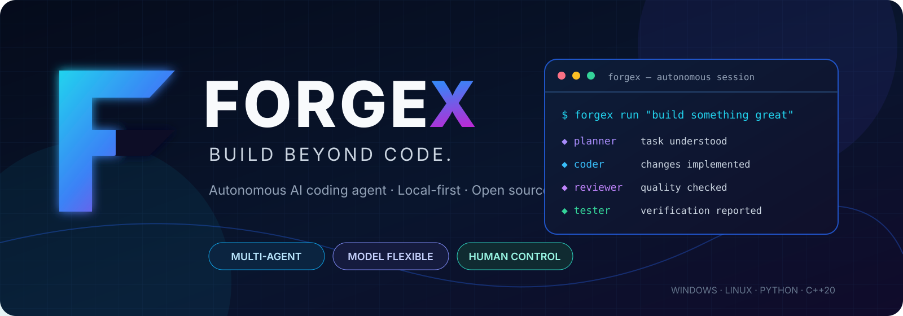

# FORGEX

<div align="center">

# FORGEX
### Build Beyond Code.

**Current release: v1.0.0** · Initial public release line

**An open-source, terminal-first AI coding agent that helps you understand, build, debug, and improve real codebases.**

[](https://github.com/Abir-Ghosh-sudo/FORGEX/actions/workflows/ci.yml)
[](https://github.com/Abir-Ghosh-sudo/FORGEX/releases)
[](https://www.python.org/)
[](LICENSE)
[](https://github.com/Abir-Ghosh-sudo/FORGEX)



[Getting Started](#-getting-started) · [Features](#-what-is-forgex) · [CLI](#-command-line) · [Architecture](#-how-it-works) · [Contributing](#-contributing)

</div>

---

## ⚡ What is FORGEX?

FORGEX is a **terminal-first autonomous AI coding agent** designed to work with your repository—not just answer questions about code.

Give it a task in natural language. FORGEX can plan the work, inspect the project, produce implementation changes, review the result, and run available tests through a coordinated agent workflow. You stay in control with workspace boundaries, permission checks, and approval gates for sensitive operations.

Use local models for privacy and offline-oriented workflows, or connect the model runtime that fits your environment.

> **Your terminal. Your codebase. Your models. Your control.**

## ✨ What is inside?

| Capability | What it does |
|---|---|
| 🤖 Multi-agent workflow | Coordinates Planner, Coder, Reviewer, and Tester roles. |
| 🧭 Repository understanding | Inspects project structure, source files, and code context. |
| 🛠️ Coding actions | Creates, edits, and removes project files and can run development commands. |
| 🔍 Review and verification | Reviews generated changes and runs available project tests. |
| 🧠 Model flexibility | Supports local model runtimes including Ollama, llama.cpp, and Hugging Face Transformers. |
| 🔐 Permission-aware execution | Applies security policy, workspace checks, and approval handling to sensitive operations. |
| 🧰 Developer tools | Includes filesystem, terminal, Git, package, and testing toolkits. |
| 🔌 Extensibility | Provides foundations for MCP, skills, and plugins. |
| ⚙️ Optional native engine | C++20 and pybind11 components for accelerated parsing, indexing, and search. |
| 🖥️ Cross-platform | Targets Windows and Linux, with a Python fallback when native compilation is unavailable. |

## 🧰 What can FORGEX help you do?

Describe a development task in plain language and use FORGEX as a terminal-based coding companion for work such as:

- **Understand an unfamiliar repository** — inspect its structure, identify important files, and get a starting point for a change.
- **Plan implementation work** — turn a feature request or bug report into a sequence of engineering tasks.
- **Create and improve code** — generate implementation actions for new features, fixes, and refactors.
- **Investigate bugs** — trace likely causes, inspect relevant code, and work through a proposed fix.
- **Run development commands** — execute supported project commands through the supervised terminal path and handle approval prompts.
- **Review and test changes** — use the reviewer/tester workflow and available project test tooling to report verification results.
- **Work with Git** — inspect repository state and use the Git toolset for common repository operations.
- **Use local AI models** — connect supported local runtimes so your source code can stay on your machine, subject to the model/runtime you configure.
- **Search and navigate code** — use repository context, parsers, and search tools to locate relevant code.

### Example tasks

```text
forgex run "Explain how authentication works in this repository"
forgex run "Find the cause of the failing login test and propose a fix"
forgex run "Add input validation to the user registration endpoint"
forgex run "Refactor duplicated date parsing logic"
forgex run "Run the test suite and summarize failures"
```

These are example task prompts, not guarantees that every repository or model will complete every task autonomously. Results depend on model capability, project setup, available tests, and enabled permissions. Review generated changes before merging them.

## 🏷️ Version and release

**Current project version: `v1.0.0`**

The package version is defined in `pyproject.toml` and exposed by `forgex --version`. The README version badge tracks this project version. Check the [GitHub Releases](https://github.com/Abir-Ghosh-sudo/FORGEX/releases) page for published release notes and downloadable assets; a version number in the source does not by itself mean a GitHub release has been published.

## 🚀 Getting Started

### Requirements

- Python **3.11 or newer**
- Git
- A supported model runtime and a coding model
- C++20 toolchain only if you want to build the optional native extension

### Quick install directly from the terminal

You can install FORGEX straight from GitHub without manually cloning the repository.

**Windows (PowerShell):**

```powershell
py -3.11 -m venv $env:USERPROFILE\\forgex-env
& $env:USERPROFILE\\forgex-env\\Scripts\\Activate.ps1
python -m pip install --upgrade pip
python -m pip install "git+https://github.com/Abir-Ghosh-sudo/FORGEX.git"
forgex --version
forgex doctor
```

**Linux:**

```bash
python3 -m venv ~/forgex-env
source ~/forgex-env/bin/activate
python -m pip install --upgrade pip
python -m pip install "git+https://github.com/Abir-Ghosh-sudo/FORGEX.git"
forgex --version
forgex doctor
```

Keep the virtual environment activated whenever you use the `forgex` command. To leave it, run `deactivate`. To update later, run:

```bash
python -m pip install --upgrade "git+https://github.com/Abir-Ghosh-sudo/FORGEX.git"
```

### 1. Clone the repository

```bash
git clone https://github.com/Abir-Ghosh-sudo/FORGEX.git
cd FORGEX
```

### 2. Create and activate a virtual environment

**Windows (PowerShell):**

```powershell
python -m venv .venv
.\.venv\Scripts\Activate.ps1
```

**Linux:**

```bash
python3 -m venv .venv
source .venv/bin/activate
```

### 3. Install FORGEX

For development and the standard Python installation:

```bash
python -m pip install --upgrade pip
pip install -e ".[dev]"
```

Install optional integrations when you need them:

```bash
# Ollama integration
pip install -e ".[local]"

# Hugging Face Transformers runtime
pip install -e ".[transformers]"

# Model Context Protocol support
pip install -e ".[mcp]"

# Vector-store support
pip install -e ".[vector]"
```

### 4. Set up a local model

One option is [Ollama](https://ollama.com/). Install Ollama, start its service, and pull a coding model:

```bash
ollama pull qwen2.5-coder:7b
```

Then verify your environment:

```bash
forgex --version
forgex doctor
forgex model list
```

> Model availability and hardware requirements depend on the model you choose. Larger models need more RAM/VRAM. Use a quantized model that fits your machine.

### 5. Initialize and start coding

From the repository or project directory you want FORGEX to work in:

```bash
forgex init
forgex analyze
forgex run "Find and fix the bug in the login flow"
```

Start an interactive session with:

```bash
forgex chat
```

**Tip:** Review proposed changes and approve sensitive operations carefully. Commit or back up important work before running autonomous tasks.

## ⌨️ Command Line

| Command | Purpose |
|---|---|
| `forgex --version` | Show the installed version. |
| `forgex doctor` | Check the environment and runtime availability. |
| `forgex init [PATH]` | Initialize FORGEX configuration for a project. |
| `forgex analyze [PATH]` | Inspect a project and its structure. |
| `forgex run "TASK"` | Execute an autonomous coding task. |
| `forgex chat` | Open an interactive coding session. |
| `forgex model list` | Inspect available local models. |
| `forgex model pull MODEL` | Download a supported model. |
| `forgex git status` | Inspect repository status. |
| `forgex test run` | Discover and run project tests. |
| `forgex config show` | Display the current configuration. |
| `forgex session` | Manage coding sessions. |

For command-specific options, use:

```bash
forgex --help
forgex COMMAND --help
```

## 🧱 Core building blocks

| Area | Included building blocks |
|---|---|
| Agent orchestration | Planner, Coder, Reviewer, Tester roles and workflow state |
| Model layer | Model manager and Ollama, llama.cpp, Transformers integrations |
| Context | Repository inspection, parsing, indexing, and search components |
| Developer tools | Filesystem, terminal, Git, package management, and test tooling |
| Runtime | Process supervision, platform adapters, and execution limits |
| Security | Workspace boundaries, policy evaluation, permission checks, and approval hooks |
| Persistence | SQLite-backed sessions and storage repositories |
| Native engine | Optional C++20 components exposed through pybind11 |

## 🧩 How it works

FORGEX uses a stateful workflow to coordinate specialized agents and developer tools.

```text
                 YOUR TASK
                    │
                    ▼
             ┌─────────────┐
             │   PLANNER   │  Understands the goal and breaks down work
             └──────┬──────┘
                    ▼
             ┌─────────────┐
             │    CODER    │  Produces and executes implementation actions
             └──────┬──────┘
                    ▼
             ┌─────────────┐
             │   REVIEWER  │  Reviews the implementation
             └──────┬──────┘
                    ▼
             ┌─────────────┐
             │   TESTER    │  Runs available tests and reports results
             └──────┬──────┘
                    │
             Fix / re-check loop
                    │
                    ▼
             ┌─────────────┐
             │   RESULT    │  Changes, output, and verification report
             └─────────────┘
```

The workflow is backed by reusable components for model access, context retrieval, filesystem operations, terminal execution, Git, testing, security, sessions, and storage.

## 🧠 Model runtimes

FORGEX is designed to keep model selection flexible. The current runtime integrations include:

- **Ollama** — run supported models through a local Ollama service.
- **llama.cpp** — use compatible local GGUF model setups.
- **Hugging Face Transformers** — load supported models through the Transformers ecosystem and cached model files.

Model compatibility, tool-calling behavior, memory usage, and performance vary by model and runtime. Check each model's official card and license before downloading or using it.

## ⚡ Optional C++20 acceleration

The Python implementation is the fallback path; a native build is optional. To compile the extension, install a working C++20 compiler, CMake, Ninja, and pybind11:

```bash
pip install pybind11 cmake ninja
cmake -S . -B build -G Ninja -DCMAKE_BUILD_TYPE=Release -DFORGEX_BUILD_PYTHON=ON
cmake --build build --config Release
```

On Windows, use a supported Visual Studio C++ Build Tools installation and run the commands from a configured developer environment. If you do not have a native toolchain, continue using the Python installation.

## 🧪 Development

Install development dependencies:

```bash
pip install -e ".[dev]"
```

Run the checks:

```bash
# Test suite
pytest tests

# Lint
ruff check src

# Formatting check
ruff format --check src
```

Native extension tests can be run when the extension has been built:

```bash
pytest tests/unit/test_native_engine.py
```

## 🔒 Security

FORGEX is built around human-controlled execution:

- Keep work scoped to the intended project workspace.
- Review permission prompts before allowing sensitive operations.
- Avoid running untrusted repositories or model-generated commands with elevated privileges.
- Never place API keys, passwords, or other secrets in prompts or committed files.
- Use Git commits or backups before large autonomous changes.

**Important:** Application-level policy checks are defense-in-depth; they are not a replacement for operating-system isolation. For untrusted code, use a disposable container, virtual machine, or other OS-level sandbox with restricted network and filesystem access.

## 📌 Support and limitations

- **Operating systems:** Windows and Linux are the primary targets.
- **Python:** 3.11+.
- **Native engine:** Optional; the Python path is available when a native compiler is not installed.
- **Model runtime:** Ollama, llama.cpp, and Hugging Face Transformers integrations are included; individual model compatibility varies.
- **Network access:** Required for first-time package/model downloads unless dependencies and model files are already cached.
- **Autonomy:** FORGEX is a development tool, not an unattended production deployment system. Keep approval prompts enabled for commands and review code changes.
- **Verification:** A reported test result only covers the tests that were actually discovered and executed. No test run is not a passing test run.

## 🗺️ Project status

FORGEX is under active development. The repository contains the core CLI, agent workflow, model integrations, developer toolkits, security and runtime components, optional native engine, and supporting infrastructure. Provider coverage and platform behavior may vary by environment.

If you find a bug or have an idea, please open an issue with reproduction steps and relevant logs (remove secrets first).

## 🤝 Contributing

Contributions are welcome!

1. Fork the repository.
2. Create a focused branch: `git checkout -b feature/your-feature`.
3. Make your changes and add or update tests.
4. Run the relevant checks locally.
5. Open a pull request describing the change and its verification.

Please keep pull requests focused and include clear reproduction steps for bug fixes.

## 📄 License

FORGEX is licensed under the **Apache License 2.0**. See [LICENSE](LICENSE) for details.

## 🌐 Links

- **Repository:** [github.com/Abir-Ghosh-sudo/FORGEX](https://github.com/Abir-Ghosh-sudo/FORGEX)
- **Issues:** [Report a bug or request a feature](https://github.com/Abir-Ghosh-sudo/FORGEX/issues)
- **Discussions:** [Join the conversation](https://github.com/Abir-Ghosh-sudo/FORGEX/discussions)

---

<div align="center">

**FORGEX — Build Beyond Code.**

*Plan smarter. Build faster. Stay in control.*

</div>


## 🐳 Docker

Run FORGEX in a non-root container with a read-only container filesystem, dropped Linux capabilities, resource limits, and only the project workspace mounted for editing.

### Requirements

- Docker Engine with Docker Compose v2.
- At least 4 GB RAM available to the container; increase the Compose memory limit if needed.

### Build and start interactive FORGEX

From the repository root:

```bash
docker compose build
docker compose run --rm forgex
```

The project directory is mounted at `/workspace`. FORGEX starts an interactive chat session there.

### Run a task or a diagnostic

```bash
docker compose run --rm forgex doctor
docker compose run --rm forgex run "Add input validation to the configuration loader"
```

### Linux file permissions

The Compose build uses UID/GID 1000 by default. If your Linux account uses different IDs, build with:

```bash
FORGEX_UID="$(id -u)" FORGEX_GID="$(id -g)" docker compose build
```

### Notes

- The container does not include an Ollama server or download an LLM automatically. Configure a supported model runtime separately.
- The default Docker image uses the portable pure-Python engine. Build the optional C++20 extension separately when you have a native toolchain.
- Model downloads and remote model providers need network access.
- The workspace mount is writable because FORGEX must edit project files. Do not mount your home directory, SSH keys, Docker socket, or secrets into an untrusted agent container.
- Docker adds an isolation boundary, but this default setup is not a hardened hostile-code sandbox. Review approvals and restrict networking further when running untrusted repositories.
- To rebuild after changing dependencies or source files, run `docker compose build --no-cache`.
